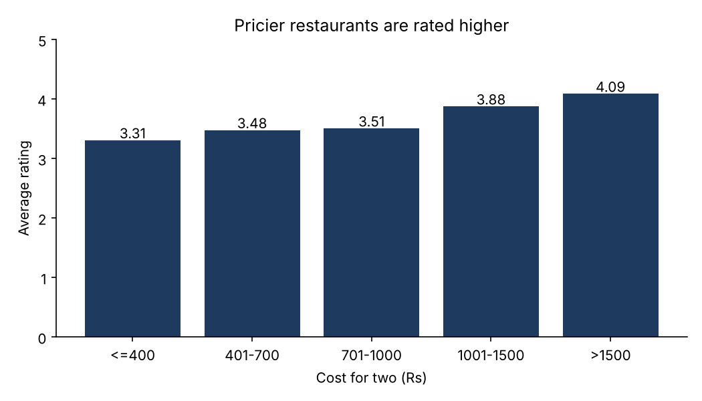
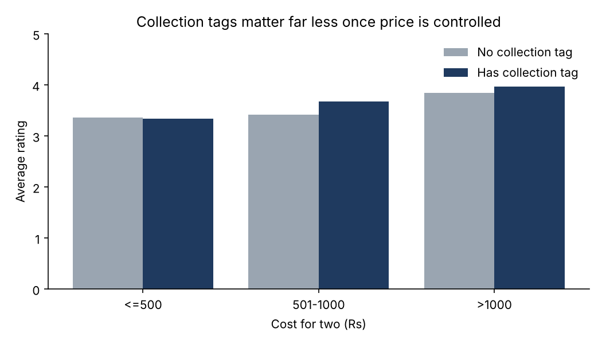
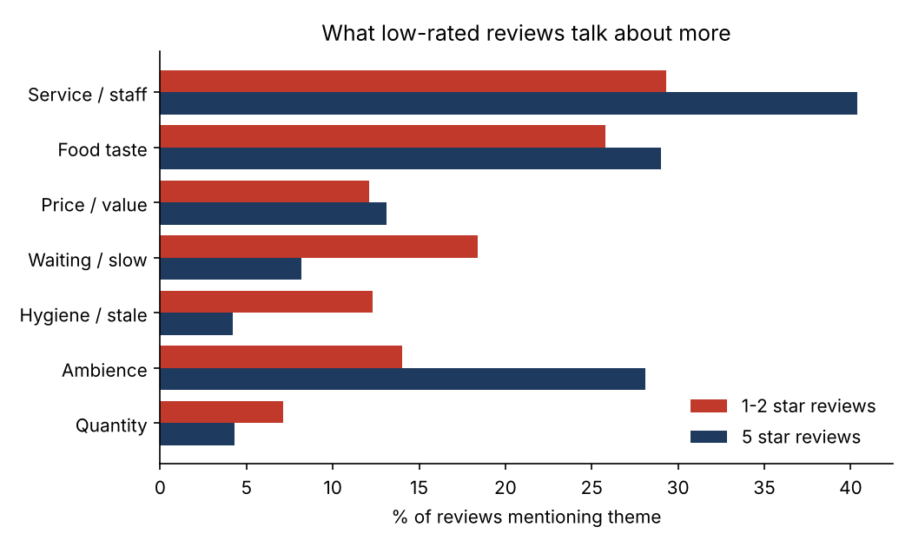
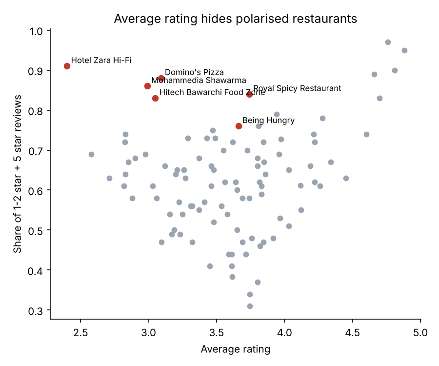

# Zomato Hyderabad Restaurants: What Drives a Rating?

Analysis of 105 Hyderabad restaurants and 9,961 customer reviews (May 2016 - May 2019) using **Python (Pandas)**, **MySQL** and **Power BI**.
The goal: find out what actually separates a highly rated restaurant from a poorly rated one, and where a plain "average rating" misleads.

## Key findings

| # | Question | Finding |
|---|----------|---------|
| 1 | Does price predict rating? | Yes. Restaurants costing over Rs 1,500 for two average **4.09** vs **3.31** for those at Rs 400 or less (Spearman rho = 0.38, p < 0.001). |
| 2 | Which cheap places are best? | Under Rs 500 for two: Udipi's Upahar (4.03), KS Bakers (3.96), GD's (3.96), Amul (3.94). |
| 3 | Do Zomato collection tags ("Top-Rated", "Hyderabad's Hottest"...) mean better food? | Tagged restaurants average 3.77 vs 3.44 untagged, but **most of that gap is price**. Inside the same price band the gap shrinks to about 0.1 on average: Rs 500 or less, 3.33 tagged vs 3.37 untagged; Rs 501-1000, 3.68 vs 3.42; over Rs 1000, 3.97 vs 3.85. |
| 4 | What do unhappy customers complain about? | Compared with 5-star reviews, 1-2 star reviews mention **waiting/slow service** about 2x as often (18.4% vs 8.2%) and **hygiene/stale food** about 3x as often (12.3% vs 4.2%). 5-star reviews talk more about ambience (28.1% vs 14.0%) and service (40.4% vs 29.3%). |
| 5 | Which restaurants split opinion? | 34 restaurants have 25%+ five-star **and** 25%+ one/two-star reviews. Most extreme: Hotel Zara Hi-Fi (64% low / 27% five), Domino's Pizza (45% / 43%), Mohammedia Shawarma (48% / 38%). Their ~3.0 average hides that people either love or hate them. |
| 6 | Does closing after midnight help? | No visible effect: 3.58 (n=43) vs 3.63 (n=56), p = 0.91. |

Smaller observations: reviews with photos are rated higher (3.86 vs 3.54); average rating fell from 3.81 (2017) to 3.52 (2018) and recovered to 3.67 (2019); Asian and Continental restaurants average highest (3.92, 3.82), Fast Food and Biryani lowest (3.33, 3.38).

## Charts

| | |
|--|--|
|  |  |
|  |  |

Full numbers: [`reports/findings.txt`](reports/findings.txt)

## How it was built

1. **Cleaning** ([`scripts/clean_data.py`](scripts/clean_data.py)): dropped 38 blank rows and 1 row with an invalid rating ("Like"); converted cost strings such as `"1,300"` to integers; parsed reviewer info (`"12 Reviews , 3 Followers"` and the `Posts` variant) with regex; parsed timestamps; split cuisines and collections into separate tables; derived a "closes at midnight or later" flag from free-text timings. Log: [`data/processed/cleaning_log.txt`](data/processed/cleaning_log.txt)
2. **SQL** ([`sql/schema.sql`](sql/schema.sql), [`sql/queries.sql`](sql/queries.sql)): MySQL 8 queries using joins, CTEs, `RANK`, `ROW_NUMBER`, `LAG`, `CASE` bucketing. [`scripts/verify_sql.py`](scripts/verify_sql.py) runs them against the cleaned CSVs and the results match the Pandas numbers.
3. **Analysis** ([`scripts/analysis.py`](scripts/analysis.py)): statistics (Spearman, Mann-Whitney) and charts.
4. **Dashboard**: Power BI build steps and DAX in [`powerbi/`](powerbi/).

## Limitations (read before quoting any number)

- **Sample, not the full site.** The data holds about 100 reviews per restaurant (mostly May 2018 to May 2019), so it describes recent sentiment, not lifetime ratings. 5 restaurants have no reviews and are excluded from rating analysis.
- **Correlation, not causation.** Price and rating move together, but this data cannot say that higher price causes higher ratings (better locations, hotels and chains also cost more and may attract friendlier reviewers).
- **Theme counts are keyword matches**, not a trained text model. They show direction, not exact shares.
- **Late-night** is derived from free-text opening hours (closes at midnight or later), so a few edge cases may be misclassified. One restaurant has no timings.
- Small groups (for example 5 restaurants in the over-Rs-1000 untagged group) give noisy averages.

## Data

Two CSV files of Zomato Hyderabad restaurant metadata and reviews, (public Zomato Hyderabad dataset; original source and licence: TO BE CONFIRMED by repo owner). Raw files are in `data/raw/` unmodified. Check the dataset page's licence before reusing the raw data; the code and analysis in this repo are my own.

## Run it

```bash
pip install -r requirements.txt
python scripts/clean_data.py
python scripts/analysis.py
python scripts/verify_sql.py
```
